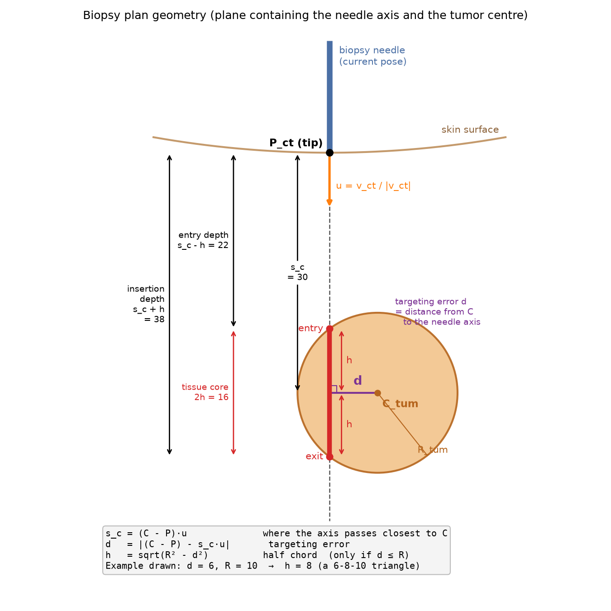
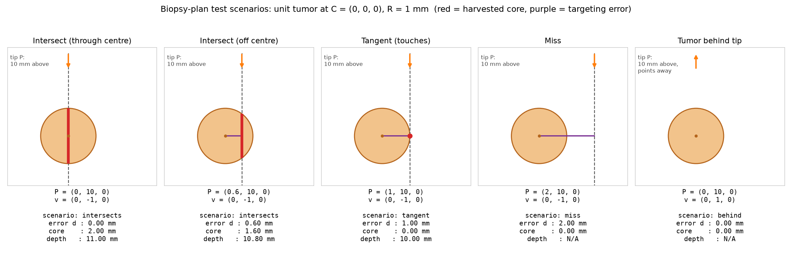

# Part 3: Biopsy Plan

CISC/CMPE 330 - CT-Guided Bone Biopsy Planning

## Overview

After registration (Part 2), we know where the needle tip is (`Pct`) and which way it points (`vct`) in CT coordinates. The tumor is modelled as a sphere `[Ctum, Rtum]`. The plan is to push the needle straight ahead along its current axis, all the way through the tumor. For the physician we compute:

| Output | Meaning |
| --- | --- |
| **Targeting error** | Distance from the needle axis to the tumor centre |
| **Tissue core length** | Length of the needle path that lies inside the tumor |
| **Needle insertion depth** | How far the tip must advance from `Pct` to harvest that whole core |

If the plan looks bad (large targeting error, short or no core), the tool is re-aimed, the patient re-imaged, and the plan recomputed. This loop is "iterative forward planning".

## Files

- `line_geometry.py`: reusable utilities: `closest_point_on_line`, `distance_point_from_line`, `intersect_line_sphere`.
- `biopsy_plan.py`: `compute_biopsy_plan()` and `format_plan()`.
- `test_biopsy_plan.py`: ground-truth tests. Run with `python3 test_biopsy_plan.py` or `pytest`.
- `make_figures.py`: generates the figures below from the code's own output.

## Method

Write the needle path as a line, using the **unit** direction `u = vct / |vct|`:

`X(s) = Pct + s · u`

Because `u` has length 1, `s` is simply "millimetres ahead of the current tip". `s > 0` is in front of the tip and `s < 0` is behind it. Normalising `u` here is important: if `vct` were not unit length, every depth below would be scaled by `|vct|`.

### 1. Targeting error (Distance-of-Point-from-Line)

Let `w = Ctum − Pct`. Split `w` into a part along the needle and a part perpendicular to it:

- `s_c = w · u`: the depth at which the axis passes closest to the tumor centre
- `d = |w − s_c · u|`: the length of the perpendicular part, which is the **targeting error**

(This equals `|w × u|`. The subtraction form is used instead of `sqrt(|w|² − s_c²)` because the latter loses precision when the tumor is far away and `d` is small.)

### 2. Tissue core (Intersect-Line-and-Sphere)

A point on the line is on the sphere when `|X(s) − C| = R`. By Pythagoras in the plane of the line and `C`:

`d² + (s − s_c)² = R²`  →  `s = s_c ∓ h`,  where  `h = sqrt(R² − d²)`

- `d < R`: two crossings. Entry at `s₁ = s_c − h`, exit at `s₂ = s_c + h`. **Core length = 2h.**
- `d = R`: one touching point. **Core length = 0.**
- `d > R`: no crossing. **Core length = 0.**

### 3. Insertion depth

A coring needle collects tissue as it advances, so to harvest the full core from `s₁` to `s₂` the tip has to reach the far tumor wall. **Insertion depth = s₂ = s_c + h**, measured from the current tip position `Pct` (where the physician placed the tip at the skin entry point).

### Edge cases

| Scenario | Condition | Core | Depth | Why it matters |
| --- | --- | --- | --- | --- |
| `intersects` | `0 ≤ s₁ < s₂` | `2h` | `s₂` | Normal case |
| `tangent` | `d = R` | 0 | `s_c` (touch point) | Needle only grazes the surface. Depth is reported so the physician sees where, but no tissue is collected |
| `miss` | `d > R` | 0 | N/A | Message says how far the axis misses the surface (`d − R`) |
| `tip_inside` | `s₁ < 0 ≤ s₂` | `s₂` | `s₂` | Tip already in the tumor. Only the forward part can be cored |
| `behind` | `s₂ < 0` | 0 | N/A | The *infinite* axis passes through the tumor, but it is behind the tip, so pushing forward never reaches it. A naive line-sphere test would report a core here |

**Tangent tolerance.** In floating point, `d == R` exactly almost never happens (e.g. `d = 0.9999999999999998`). The code treats `|d − R| ≤ 1e−9 · max(R, 1)` as tangent. The test suite checks that 1e−12 mm of round-off counts as tangent but a real 1 µm gap counts as a miss.

**Targeting error is defined on the infinite axis**, as the assignment states ("distance of the needle axis from the tumor center"). That is why the `behind` case can show a targeting error of 0. The `scenario` field is what tells the physician that forward insertion cannot reach the tumor.

## Test Scenarios

Following the hint, we use the simplest scene that is still general: a **unit tumor** (`R = 1 mm`) at `C = (0, 0, 0)`, and the needle tip 10 mm above at `P = (x₀, 10, 0)` pointing down, `v = (0, −1, 0)` (as in Fig. 6). Sliding the tip sideways by `x₀` sweeps the axis across the tumor, so **`x₀` is exactly the targeting error**, and `s_c = 10`.

### Expected values worked out on paper

| Scenario | P | d | h = √(1 − d²) | Entry s₁ | Exit s₂ | **Core** | **Depth** |
| --- | --- | --- | --- | --- | --- | --- | --- |
| Intersect (centre) | (0, 10, 0) | 0 | 1 | 9 | 11 | **2** | **11** |
| Intersect (off-centre) | (0.6, 10, 0) | 0.6 | 0.8 | 9.2 | 10.8 | **1.6** | **10.8** |
| Tangent | (1, 10, 0) | 1 | 0 | 10 | 10 | **0** | **10** |
| Miss | (2, 10, 0) | 2 | — | — | — | **0** | **N/A** |

The off-centre case uses a scaled 3-4-5 triangle (0.6, 0.8, 1), so `h` is exact without a calculator.

### Results

| Test | Expected (error / core / depth) | Computed | Pass |
| --- | --- | --- | --- |
| Intersect, through centre | 0 / 2 / 11 | 0.0000 / 2.0000 / 11.0000 | ✓ |
| Intersect, off centre | 0.6 / 1.6 / 10.8 | 0.6000 / 1.6000 / 10.8000 | ✓ |
| Tangent | 1 / 0 / 10 | 1.0000 / 0.0000 / 10.0000 | ✓ |
| Miss | 2 / 0 / N/A | 2.0000 / 0.0000 / N/A | ✓ |
| Oblique needle, `P = (5,5,0)`, `v = (−1,−1,0)` (not unit length) | 0 / 2 / 5√2 + 1 = 8.0711 | 0.0000 / 2.0000 / 8.0711 | ✓ |
| Tip inside tumor, `P = (0, 0.5, 0)` | 0 / 1.5 / 1.5 | 0.0000 / 1.5000 / 1.5000 | ✓ |
| Tumor behind tip, `v = (0, +1, 0)` | 0 / 0 / N/A | 0.0000 / 0.0000 / N/A | ✓ |

All values agree to better than 1e−9 mm. Entry and exit points are also checked against the hand-computed coordinates.

### Why the simple scenes are enough

- **Rigid invariance:** targeting error, core length and depth are all distances, so moving and rotating the whole scene (tumor + needle) must not change them. The test applies 200 random rigid motions to each scenario and gets identical outputs. So the axis-aligned unit-sphere scenes stand for every pose.
- **Brute-force check:** for 200 random scenes (random tumor size and position, random needle, some missing), we walk along the needle in 1 µm steps and count how much of the path is inside the sphere. This agrees with the formula to within 0.001 mm, which is the sampling step, and uses no formulas that could share a bug with the code.

### End-to-end: Registration → Plan

Using the registration from Part 2, Test 3 (`Pct = (50, −20, 100)`, `vct = (0, 0, −1)`), we place a tumor of realistic size, `R = 10 mm`, 80 mm ahead of the tip and 6 mm off-axis: `C = (56, −20, 20)`. On paper (6-8-10 triangle): error 6 mm, `h = 8`, entry 72, exit 88, **core 16 mm, insertion depth 88 mm**. The code reproduces this exactly.

## Assumptions and Limitations

- The tumor is a sphere. As the assignment notes, the inscribed (largest snugly-fitting) sphere is used so that the target is not overestimated. The real core through an irregular tumor can therefore be longer than predicted, but should not be shorter.
- The needle is treated as a straight line with zero thickness. A 3 mm needle actually cuts a cylinder, so a needle whose axis just misses the sphere (`d` slightly more than `R`) would still graze the tumor with its wall.
- Insertion depth goes to the far tumor wall. Clinically, the physician may stop short of the far wall if a vessel or nerve lies just beyond it (Fig. 1). This plan does not model surrounding structures.
- Depth is measured from the current tip position `Pct`. If the tip is not on the skin, the depth through tissue differs.
- Bone deflection of the needle, patient motion, and registration error are ignored here. Their effect on targeting is studied in Part 4.
