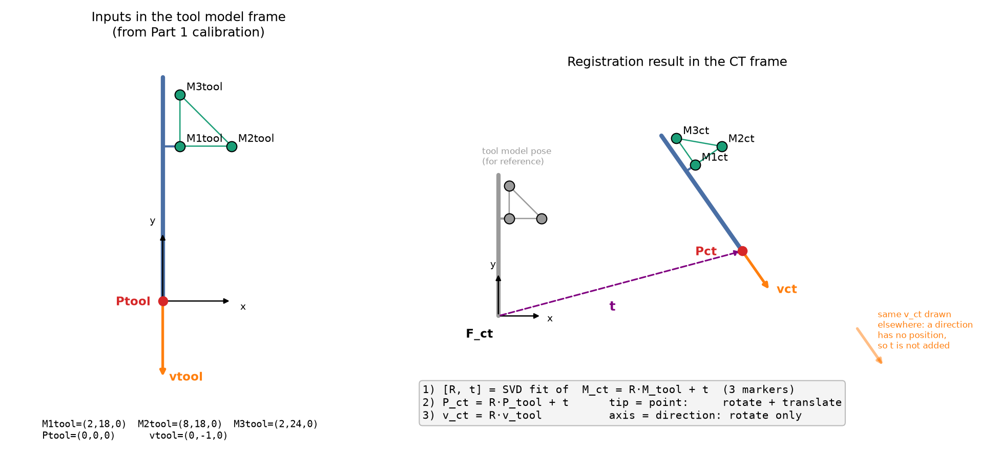
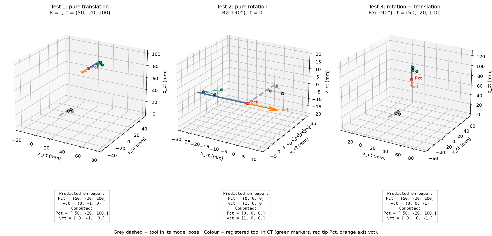

# Part 2: Registration

CISC/CMPE 330 - CT-Guided Bone Biopsy Planning

## Overview

Part 1 found the tool tip `Ptool` and axis `vtool` in the tool model frame. In this part we express both in the CT image frame. The three markers are located in the CT image stack (`M1ct`, `M2ct`, `M3ct`). We already know their model-frame positions (`M1tool`, `M2tool`, `M3tool`), so we can find the rigid transform between the two frames and use it to carry the tip and axis into CT.

| | |
| --- | --- |
| **Input** | `M1tool, M2tool, M3tool`, `Ptool`, `vtool`, `M1ct, M2ct, M3ct` |
| **Output** | `Pct` (tool tip in CT), `vct` (tool axis direction in CT) |

## Files

- `registration.py`: the registration module (`register_tool`, `transform_point`, `transform_direction`).
- `test_registration.py`: the three required tests plus extra checks. Run with `python3 test_registration.py` or `pytest`.
- `make_figures.py`: generates the figures below from the code's own output.

The SVD rigid-registration solver is **reused from Part 1** (`tool_calibration/geometry.py → rigid_registration`). It is not copied, so both parts use the same validated routine.

## Method

### Step 1: Rigid transform from the markers

We look for a rotation `R` and translation `t` with

`M_ct = R · M_tool + t` for each of the three markers.

Three non-collinear markers fix all 6 degrees of freedom. (Two markers would leave the rotation about the line through them unknown.) We solve with the SVD (Arun/Kabsch) least-squares method:

1. Subtract each marker set's centroid. With both centroids at the origin, the translation drops out and only the rotation is left to find.
2. Build the 3×3 cross-covariance `H = Σ (M_tool − c_tool)(M_ct − c_ct)ᵀ` and take its SVD, `H = U S Vᵀ`.
3. `R = V · diag(1, 1, det(V Uᵀ)) · Uᵀ`. The `det` term forces `det(R) = +1`, so the result is always a true rotation and never a mirror image.
4. `t = c_ct − R · c_tool`.

With perfect data, three markers would be enough to build `R` directly from a marker frame (Gram-Schmidt, as in Part 1's `marker_frame`). We use SVD because CT marker localization is never perfect. SVD gives the least-squares best fit using all three markers equally. The marker-frame method instead trusts M1 fully (it is the origin) and M3 the least. Part 1 measured the difference with noise (6.54° vs 7.47° mean rotation error). Test 6 below checks that the two methods agree exactly on perfect data.

### Step 2: The tool tip is a point

`Pct = R · Ptool + t`

### Step 3: The tool axis is a direction

`vct = R · vtool`   (no `+ t`)

**This is the step that is easiest to get wrong.** A direction is the difference of two points. Under the transform, `(R a + t) − (R b + t) = R (a − b)`, so the translation cancels. In homogeneous coordinates, a point is `[x, y, z, 1]` and a direction is `[x, y, z, 0]`. The 0 switches off the translation column of the 4×4 matrix. Test 5 shows that treating `v` as a point turns `(0, −1, 0)` into `(50, −21, 100)` under a pure translation, which is wrong.

### Input checks

- Collinear model markers are rejected (`ValueError`).
- A rigid motion preserves the distances between markers. `register_tool` compares the three inter-marker distances in the model and CT frames. If any differs by more than 1.0 mm, the result is flagged `consistent = False`. This catches a wrong marker order or a badly localized marker.
- The fiducial registration error (RMS marker residual, `fre_rms`) is also returned.

## Test Cases (predicted on paper, then computed)

Ground-truth tool (Fig. 2): `M1 = (2, 18, 0)`, `M2 = (8, 18, 0)`, `M3 = (2, 24, 0)`, `Ptool = (0, 0, 0)`, `vtool = (0, −1, 0)` (mm).

### Test 1: Pure translation. `R = I`, `t = (50, −20, 100)`

Each marker just gains `t`:

| | Model | CT (on paper) |
| --- | --- | --- |
| M1 | (2, 18, 0) | (52, −2, 100) |
| M2 | (8, 18, 0) | (58, −2, 100) |
| M3 | (2, 24, 0) | (52, 4, 100) |
| **Pct** | (0, 0, 0) | **(50, −20, 100)** |
| **vct** | (0, −1, 0) | **(0, −1, 0)** (a direction is not translated) |

### Test 2: Pure rotation. `Rz(+90°)`, `t = 0`

`Rz(90°) = [[0, −1, 0], [1, 0, 0], [0, 0, 1]]`, so `(x, y, z) → (−y, x, z)`.

| | Model | CT (on paper) |
| --- | --- | --- |
| M1 | (2, 18, 0) | (−18, 2, 0) |
| M2 | (8, 18, 0) | (−18, 8, 0) |
| M3 | (2, 24, 0) | (−24, 2, 0) |
| **Pct** | (0, 0, 0) | **(0, 0, 0)** (the tip is on the rotation centre) |
| **vct** | (0, −1, 0) | **(1, 0, 0)** |

### Test 3: Rotation + translation. `Rx(+90°)`, then `t = (50, −20, 100)`

We rotate about a different axis from Test 2, so x, y and z all get used. `Rx(90°) = [[1, 0, 0], [0, 0, −1], [0, 1, 0]]`, so `(x, y, z) → (x, −z, y)`. We rotate first, then add `t`:

| | Model | After Rx(90°) | CT (on paper) |
| --- | --- | --- | --- |
| M1 | (2, 18, 0) | (2, 0, 18) | (52, −20, 118) |
| M2 | (8, 18, 0) | (8, 0, 18) | (58, −20, 118) |
| M3 | (2, 24, 0) | (2, 0, 24) | (52, −20, 124) |
| **Pct** | (0, 0, 0) | (0, 0, 0) | **(50, −20, 100)** |
| **vct** | (0, −1, 0) | (0, 0, −1) | **(0, 0, −1)** |

### Results

| Test | Predicted Pct | Computed Pct | Predicted vct | Computed vct | Max error |
| --- | --- | --- | --- | --- | --- |
| 1 Translation | (50, −20, 100) | (50, −20, 100) | (0, −1, 0) | (0, −1, 0) | ~1e−14 |
| 2 Rotation | (0, 0, 0) | (0, 0, 0) | (1, 0, 0) | (1, 0, 0) | ~5e−15 |
| 3 Both | (50, −20, 100) | (50, −20, 100) | (0, 0, −1) | (0, 0, −1) | ~4e−15 |

The recovered `R` and `t` also match the true values to about 1e−15, and `det(R) = +1` in every case.

### Additional checks

| Test | What it checks | Result |
| --- | --- | --- |
| 4 Off-origin tip | With `Ptool = (0,0,0)`, `Pct = t` in every test, so the rotation never acts on the tip. Using Part 1's offset tip `(3, −2, 5)` with the Test 3 pose: `Rx(90°)·(3,−2,5) = (3,−5,−2)`, `+ t = (53, −25, 98)` | Matches |
| 5 Point vs direction | `[v, 1]` gives the wrong `(50, −21, 100)`; `[v, 0]` gives the correct `(0, −1, 0)` | Demonstrated |
| 6 Marker-frame cross-check | SVD and Part 1's Gram-Schmidt `marker_frame` give the same `R`, `t` | Agree to ~1e−14 |
| 7 Random poses | 500 random rotations (any axis, ±180°) and translations | Worst error 5e−14 mm |
| 8 Bad inputs | Collinear markers rejected; a CT marker moved 5 mm flagged (distance mismatch 2.40 mm); zero axis rejected | Passed |
| 9 Part 1 → Part 2 | `calibrate_tool()` output from Part 1 (not the ground truth) fed straight into `register_tool()` | Matches to ~1e−8 |
| 10 M2/M3 swapped | Swapping the two markers that are both 6 mm from M1 | Zero residual but wrong pose (see Limitations) |

## Limitations

- With exactly three markers, there is little redundancy: 9 measured coordinates and 6 unknowns. A single badly localized marker pulls the whole pose, and the consistency check can detect it but not correct it. More markers, spread further apart, would make the registration more robust.
- These tests use error-free marker positions. The effect of CT marker-localization error on `Pct` and `vct` belongs to Part 4 (Targeting Error Simulation), which reuses `register_tool`.
- **Marker labelling ambiguity (Test 10).** The code assumes it is known which CT blob is M1, M2 and M3. M1 can be identified from distances, because it is the corner opposite the 8.49 mm side. M2 and M3 cannot, because both are 6 mm from M1. If they are swapped, the marker triangle is mirrored. For three coplanar points, a mirror image can always be reproduced by a real rotation, so the registration returns **zero residual and passes the consistency check**. The result is still wrong: in Test 10 the tip is 22.6 mm off and the axis is turned 90°. No residual-based check can catch this. The fix has to be in the hardware or the labelling: unequal marker spacing, a fourth non-coplanar marker, or a visual check of the rendered tool against the CT before trusting the plan.
