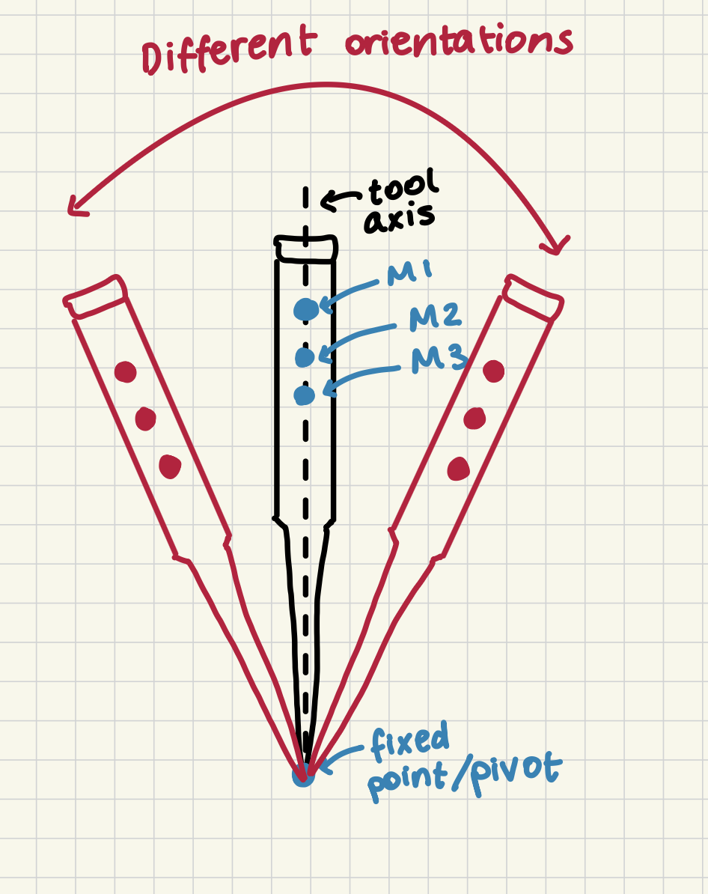
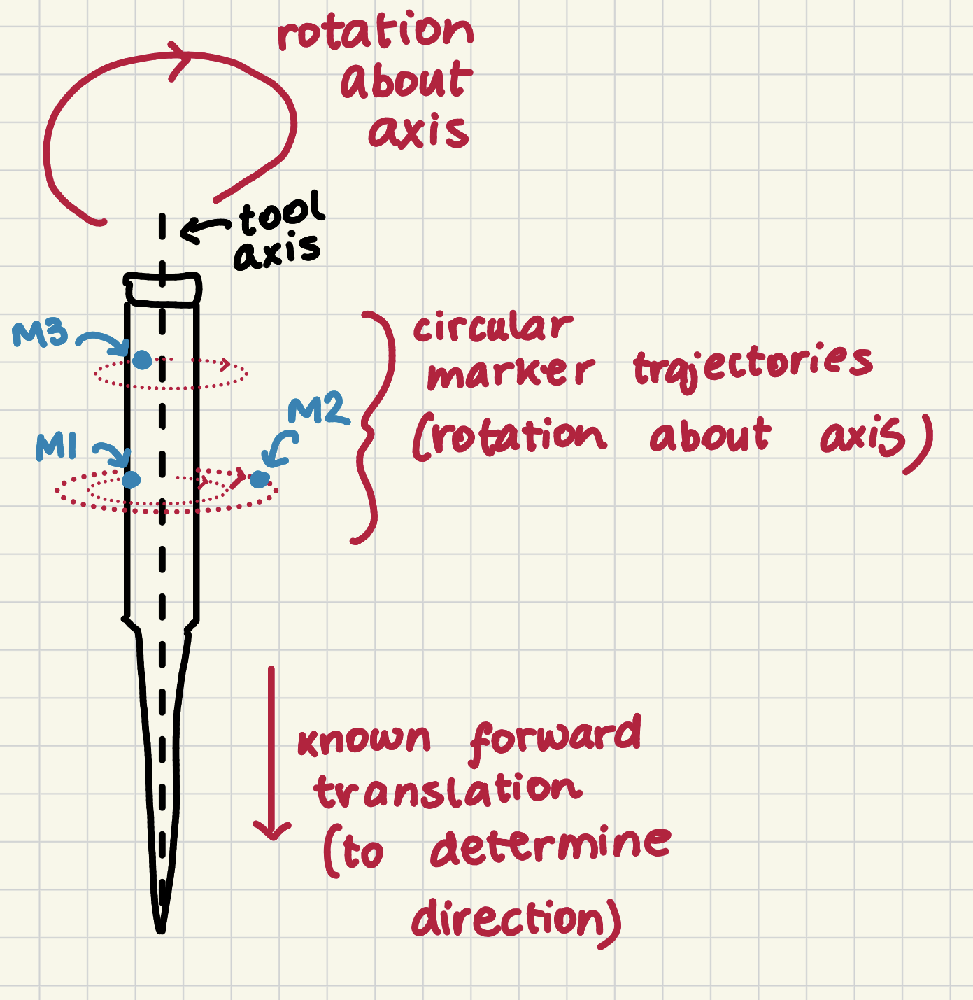

# Part 1: Tool Calibration

CISC/CMPE 330 - CT-Guided Bone Biopsy Planning

## Overview

This part of the assignment finds the tip position and axis direction of the biopsy tool. The tool has three tracked markers whose positions relative to each other are known. The tip and axis are not known, so we calibrated them from simulated optical tracker data using two motions:

- **Pivot calibration:** the tool rotates while its tip stays at one fixed point. This gives the tip.
- **Axis calibration:** the tool spins around its own axis. The markers trace circles, and the circles give the axis direction.

We simulated both motions in Python and tested the code with perfect marker measurements and with Gaussian noise.

## Summary of Results

| Experiment | Tip error (mean) | Axis error (mean) |
| --- | --- | --- |
| Perfect measurements | Approximately 0 mm | Approximately 0° |
| Separate noisy calibration tests, unrestricted pivot | 0.414 mm | 0.79° |
| Noisy complete pipeline, 30° pivot cone | 2.02 mm | 0.85° |

The first noisy row combines results from separate tip and axis calibration experiments. The final row comes from testing the complete calibration pipeline together.

The unrestricted pivot is a best-case setup. A hand-held needle could not move that freely, so the 30° row is a more realistic example of restricted motion. Section 5 shows how fast the tip error grows as the pivot range shrinks. The axis results use 36 poses averaged in the model frame (Section 4).

## Files

- `geometry.py`: rotations, coordinate frames, rigid registration, plane fitting, angle errors.
- `calibration.py`: tip and axis calibration.
- `simulation.py`: simulated marker data and measurement noise.
- `test_calibration.py`: all tests and comparisons.

## 1. Tool Geometry

Marker positions in the tool model frame:

| Marker | Position (mm) |
| --- | --- |
| M1 | (2, 18, 0) |
| M2 | (8, 18, 0) |
| M3 | (2, 24, 0) |

For the simulation, the true tip is at (0, 0, 0) mm and the true axis points along (0, -1, 0). These values are only used to generate data and to score the results. The calibration functions never see them. They only receive the marker positions.

Despite the assignment instructions allowing the tracker frame to match the model frame, Most of our tests use a randomly rotated tracker pose, which is a stricter check of the frame handling.

For every observed pose we estimated the tool's rotation `R` and translation `t` by rigid registration, so that:

`observed = R @ model + t`

 SVD-based least squares registration was used because it uses all three markers. We also kept the simpler marker-frame method (building a frame from M1, M2 and M3) so the two could be compared under noise. 

## 2. Calibration Motions and Constraints

| Motion | Constraint | What it gives |
| --- | --- | --- |
| Pivot | The tip stays fixed while the tool changes orientation | The tip position |
| Axial rotation | The tool spins about its axis, so each marker moves on a circle in a plane perpendicular to the axis | The axis direction, without its sign |
| Forward translation | The tool moves forward without changing orientation | Which of the two axis directions is correct |

The pivot motion has to change the needle's direction. If the tool only spins about one axis, the tip position along that axis cannot be recovered. The forward motion only helps with the sign. The code uses the direction of the marker displacement, not the 5 mm distance, and it relies on "forward" meaning toward the tip.

### Pivot Calibration

During the pivot, every pose satisfies:

`R_i @ p + t_i = q`

where `p` is the unknown tip in the model frame and `q` is the fixed pivot point in the tracker frame. Stacking the equations for all poses gives a linear system with six unknowns, which we solve by least squares.  We used 30 pivot poses and solved the combined system using least squares. Since R_i and t_i map model coordinates to tracker coordinates, the estimated tip position comes out directly in the model frame.

### Axis Calibration

We simulated a full turn about the tool axis with 36 poses. Each marker's path lies in a plane perpendicular to the axis, so the plane normal is the axis direction.

Our first version fitted one plane per marker and averaged the three normals. The better version fits one common normal to all three trajectories, with each trajectory centered separately. This works better because a marker on a bigger circle carries more information. M2 moves on a circle of radius 8 mm, while M1 and M3 use 2 mm.

The fitted axis is in the tracker frame and has no sign. To express it in the model frame, we convert it with the rotation from every one of the 36 registered poses and average the results. In a pure axial spin the model-frame axis is the same for every pose, so averaging reduces registration noise.

The sign comes from the forward motion, as described above.

## 3. Adding Measurement Noise

We added independent Gaussian noise with standard deviation `sigma` to every marker coordinate.

The requirement is that 95% of the 3D marker position errors are under 1 mm. That is a statement about the size of a 3D error, not about one coordinate. The 3D error divided by `sigma` follows a chi distribution with 3 degrees of freedom. Its 95th percentile is the square root of 7.815, about 2.7955. So:

`sigma = 1 / 2.7955 = 0.3577 mm`

We used `sigma = 0.357720 mm`. The usual 1.96 sigma rule is for a single coordinate, so it does not apply here.

This was then checked with 100,000 simulated errors:

| Measurement | Result |
| --- | --- |
| Noise standard deviation | 0.357720 mm |
| 95th percentile of 3D error | 0.9987 mm |
| Errors below 1 mm | 95.0450% |

## 4. Calibration Results

### Perfect Measurements

With no noise, the estimated tip and axis matched the ground truth to numerical precision (errors around 1e-14). We also tested a tip at (3, -2, 5) mm and a randomly rotated starting pose, so the code is not only working for the simple original setup.

The registration tests passed too. One test reflects four points that are not in the same plane. The estimated rotation still had a determinant of +1, and the residual was 3.0000 mm, so the code does not accept a mirror image as a rotation. We used four points because a mirrored flat set of points, like the three markers, can also be matched by a proper rotation.

### Rigid Registration with Noise

We compared SVD registration with the marker-frame method over 300 noisy trials.

| Measurement | Result |
| --- | --- |
| SVD mean rotation error | 6.54° |
| Marker-frame (Gram-Schmidt) mean rotation error | 7.47° |
| Mean registration RMS | 0.3285 mm |

SVD was a bit better. With three markers, there are 9 coordinates and 6 pose parameters, so the fit absorbs part of the noise. The RMS should land close to sigma and a little below it, and 0.33 mm against 0.358 mm fits that.

### Tool-Tip Calibration with Noise

200 trials, independent noise each time, on the same 30 pivot poses.

| Method | Mean tip error | 95th percentile |
| --- | --- | --- |
| Marker-frame registration | 0.503 mm | 0.819 mm |
| SVD registration | 0.414 mm | 0.762 mm |

**These results use a very wide pivot.** The needle directions were up to about 174° apart, so this is an optimistic setup. The restricted pivots in Sections 5 and 6 give much larger errors, so 0.414 mm should not be read as the accuracy for every kind of calibration motion.

The average pivot RMS was about 2.09 mm, much larger than the tip error. They measure different things. The pivot RMS is how well the noisy poses agree on one stationary point. The markers are about 20 mm from the tip, so a small rotation error moves the extrapolated tip by a couple of millimetres in each pose. The least squares fit over 30 poses averages this down, which is why the final tip error is smaller.

### Tool-Axis Calibration with Noise

200 trials.

| Method | Mean axis error |
| --- | --- |
| Original pipeline | 6.15° |
| Common plane, single pose | 4.93° |
| Common plane, averaged over 36 poses | 0.79° |

The original pipeline fitted a plane for each marker, averaged the normals, and used one marker-frame pose to convert to the model frame. The improved version uses the common plane normal and SVD registration, first with one pose and then with all 36.

Most of the improvement came from averaging over the 36 poses. A single pose carries the registration noise of that one measurement, and averaging reduces it. The common plane fit also improved the tracker-frame axis error from 1.37° to 0.67°.

## 5. Effect of Pivot Motion on Tip Accuracy

We limited the maximum tilt of the needle and repeated the noisy calibration 100 times per setting. Angular coverage here means the largest angle between any two needle directions in the pivot.

| Maximum tilt | Angular coverage | Condition number | Mean tip error | 95th percentile |
| --- | --- | --- | --- | --- |
| 10° | 19.3° | 18.25 | 9.14 mm | 11.01 mm |
| 20° | 37.5° | 9.16 | 3.42 mm | 4.84 mm |
| 30° | 57.1° | 7.10 | 2.31 mm | 3.64 mm |
| 45° | 77.3° | 4.12 | 1.03 mm | 1.80 mm |
| 90° | 163.7° | 2.24 | 0.52 mm | 0.90 mm |
| 180° | 178.6° | 1.42 | 0.43 mm | 0.74 mm |

Tip accuracy gets much worse when the tool can only move through a small range of angles. At 10° the mean error was 9.14 mm, and with a wide pivot it was about 0.43 mm. The condition number falls as coverage increases, so the tip estimate is less sensitive to noise with a wider pivot.

The 180° row and the earlier full-sphere experiment (0.414 mm) used different random pose sets, so they are separate results even though they are close.

## 6. Complete Calibration Test

We ran the whole pipeline with the tip at (3, -2, 5) mm and the pivot limited to a 30° cone. This 30° cone is an example of restricted motion that we chose. We ran 200 trials with the same motions and new noise each time, then 100 trials where the motions were redrawn each time.

| Measurement | Fixed motions | Redrawn motions |
| --- | --- | --- |
| Mean tip error | 2.02 mm | 2.09 mm |
| Mean axis error | 0.85° | 0.81° |
| 95th percentile tip error | 3.23 mm | 3.39 mm |
| 95th percentile axis error | 1.76° | 1.65° |

The two runs gave similar results, which suggests that the fixed-motion result was not unusually dependent on the particular poses used.

### Axial and Perpendicular Tip Error
The tip error was split into 2: a part along the needle and a part sideways. 
| Error component | Fixed motions | Redrawn motions |
| --- | --- | --- |
| Along the axis (absolute) | 1.97 mm | 2.04 mm |
| Perpendicular to the axis | 0.34 mm | 0.35 mm |

At the 30° limit, most of the error is along the needle. That fits the sweep in Section 5, where a narrow pivot gives larger tip errors. 
For the axis error we also computed the sideways shift over an assumed 100 mm insertion. The mean was 1.49 mm for fixed motions and 1.42 mm for redrawn motions. This is only a geometric illustration of the axis error alone. It is not a clinical targeting error, and the tip error is reported separately.

### Test Bounds

The noisy end-to-end tests assert a mean tip error under 3.5 mm and a mean axis error under 1.5°. I set these after running the simulation, at roughly 1.5 to 2 times the measured means, so they work as regression checks. They are not clinical requirements.

## 7. Limitations

- The noise is independent and the same in every direction. Real trackers are usually less accurate in some directions, often along the viewing depth.
- The motions are ideal. The tip does not drift during the pivot and the tool does not wobble during the spin.
- The markers are only 6 mm apart on two sides of the triangle, which makes the rotation estimate sensitive to small position errors. A wider marker array might help, but it was not tested
- The 30° cone and the 100 mm depth are example values that were chosen.

## Conclusion

With perfect data, both calibrations recover the true tip and axis. With noise, SVD registration improved the tip estimate, and the common plane fit plus averaging over poses gave the big gain in the axis estimate (6.15° down to 0.79°).

The pivot range turned out to matter a lot. A wide pivot gave about 0.4 mm of tip error, while a 30° cone gave about 2 mm, mostly along the needle. Marker noise limited the axis error to under a degree on average in these tests, and the choice of calibration motion had the biggest effect on the tip.
